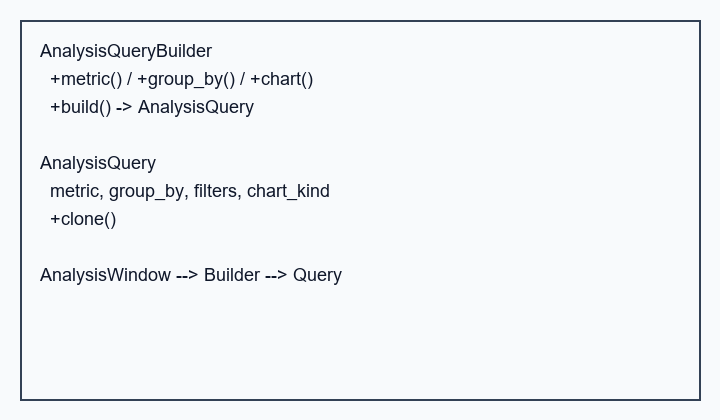
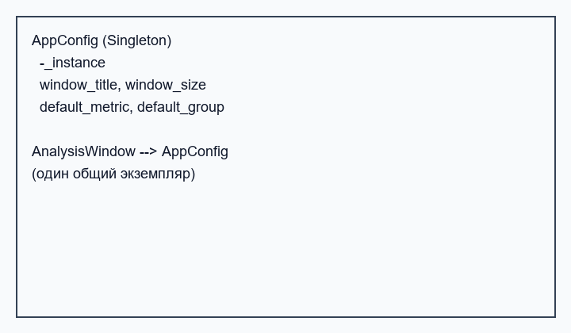

# Отчёт по лабораторной работе № 1

**Тема:** порождающие паттерны «Одиночка» и «Строитель»

## Цель работы

Изучить порождающие паттерны «Одиночка» и «Строитель» и использовать их для решения практических задач.

## Вариант 13. Интерактивный анализ набора данных

Приложение загружает набор продаж, позволяет задать фильтры и метрики, строит сводку и график. Пользователь меняет параметры запроса и сразу видит обновлённый анализ.

**Технологии:** Python 3.11, pandas, matplotlib, tkinter.

## Ход работы

### Паттерн «Строитель»

У запроса анализа несколько независимых параметров: метрика, группировка, фильтры региона/категории/канала и тип графика. `AnalysisQueryBuilder` задаёт их по шагам и возвращает готовый `AnalysisQuery`.



*Рисунок 1 - Диаграмма классов паттерна «Строитель».*

### Исходный код

**Листинг 1 — Строитель AnalysisQueryBuilder и его использование.**

```python
class AnalysisQueryBuilder:
    """Пошагово собирает AnalysisQuery."""
    def __init__(self):
        self._query = AnalysisQuery()

    def metric(self, name: str) -> "AnalysisQueryBuilder":
        self._query.metric = name
        return self

    def group_by(self, name: str) -> "AnalysisQueryBuilder":
        self._query.group_by = name
        return self

    def region(self, value):
        self._query.region = value or None
        return self

    def chart(self, kind: str) -> "AnalysisQueryBuilder":
        self._query.chart_kind = kind
        return self

    def build(self) -> AnalysisQuery:
        return self._query.clone()


# ... в окне приложения ...
def _current_query(self) -> AnalysisQuery:
    builder = AnalysisQueryBuilder()
    builder.metric(self.metric_var.get())
    builder.group_by(self.group_var.get())
    builder.chart(self.chart_var.get())
    builder.region(None if self.region_var.get() == "Все" else self.region_var.get())
    return builder.build()
```

### Паттерн «Одиночка»

Настройки окна и значения по умолчанию хранятся в `AppConfig`. Конструктор через `__new__` всегда возвращает один и тот же экземпляр, поэтому GUI и анализатор читают общие параметры.



*Рисунок 2 - Диаграмма классов паттерна «Одиночка».*

```python
class AppConfig:
    _instance = None

    def __new__(cls):
        if cls._instance is None:
            cls._instance = super().__new__(cls)
            cls._instance.window_title = "Интерактивный анализ набора данных"
            cls._instance.default_metric = "revenue"
            cls._instance.default_group = "region"
        return cls._instance
```

### Результат работы программы


*Рисунок 3 - Выручка по регионам после сборки запроса строителем.*

## Вывод

В ходе работы изучены порождающие паттерны «Одиночка» и «Строитель». «Строитель» использован для сборки запроса анализа, «Одиночка» — для общих настроек приложения.
