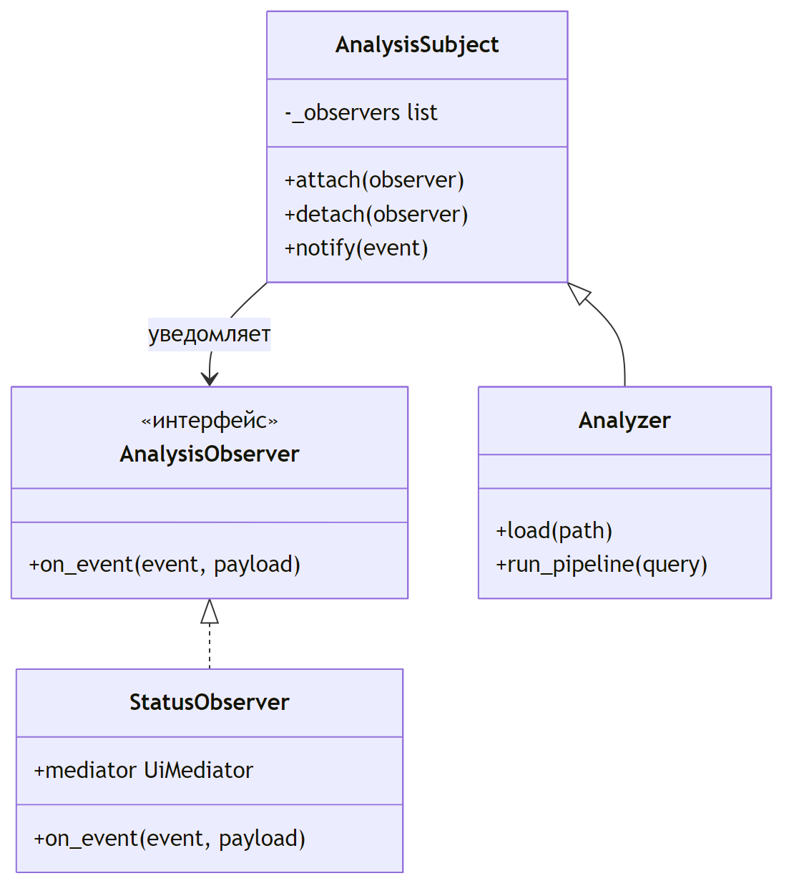
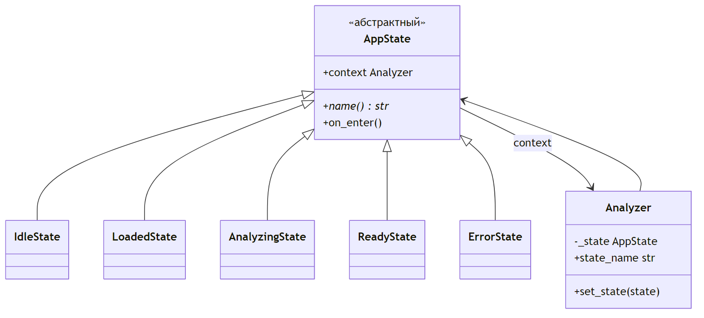

# Отчёт по лабораторной работе № 10

**Тема:** поведенческие паттерны «Наблюдатель» и «Состояние»

## Цель работы

Оповещать подписчиков об событиях анализа и менять поведение приложения по внутреннему состоянию.

## Вариант 13. Интерактивный анализ набора данных

Модель уведомляет наблюдателей о загрузке и завершении анализа. Состояния: `idle` → `loaded` → `analyzing` → `ready` / `error`.

**Технологии:** Python 3.11, pandas, matplotlib, tkinter.

## Ход работы

### Паттерн «Наблюдатель»

`Analyzer` наследует `AnalysisSubject`. `StatusObserver` подписан на события и через посредник обновляет строку статуса.

*Рисунок 1 - Диаграмма классов паттерна «Наблюдатель».*

### Паттерн «Состояние»

Классы `IdleState`, `LoadedState`, `AnalyzingState`, `ReadyState`, `ErrorState` задают имя текущего режима. При смене состояния вызывается `on_enter()`, который шлёт событие наблюдателям.

*Рисунок 2 - Диаграмма классов паттерна «Состояние».*

### Результат работы программы

*Рисунок 3 - Статус отражает текущее состояние модели.*

## Вывод

«Наблюдатель» развязал модель и UI-статус, «Состояние» явно зафиксировало этапы работы приложения анализа.
