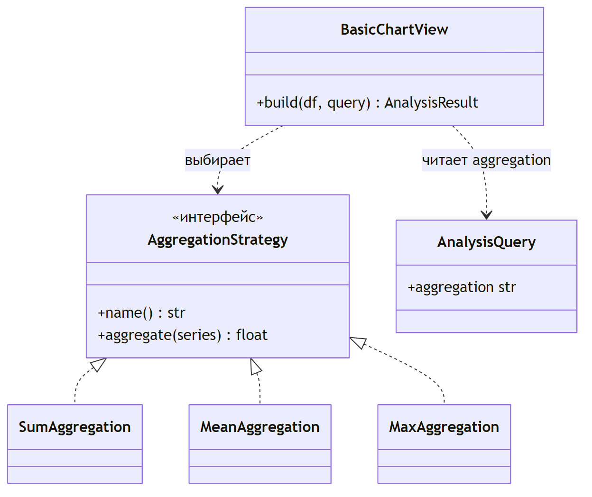
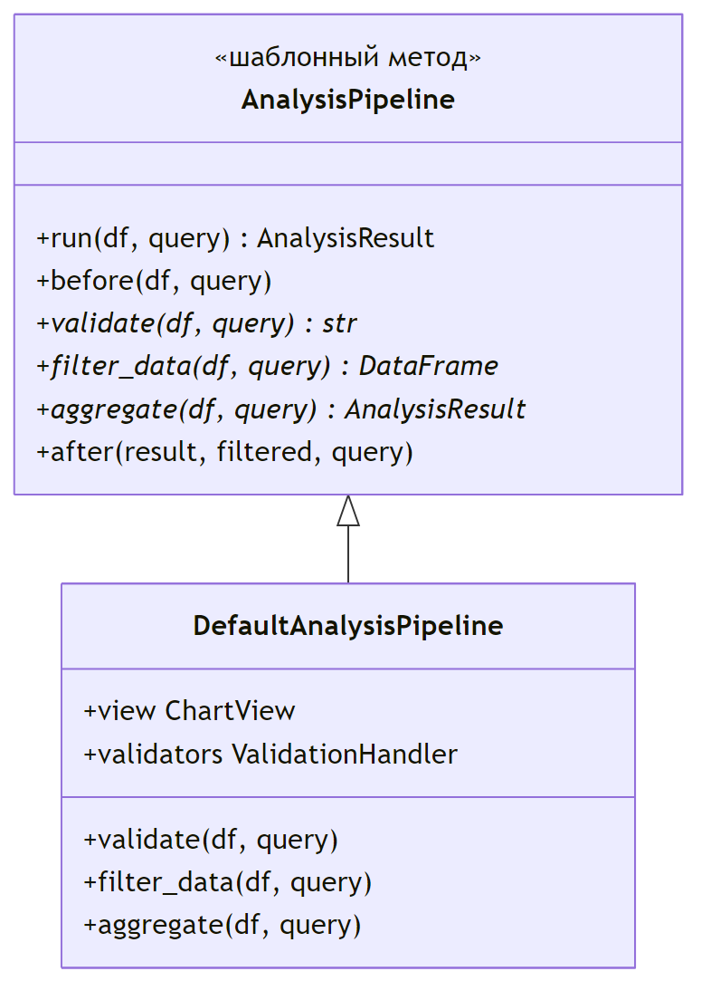
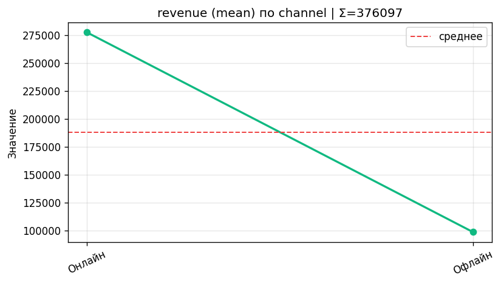

# Отчёт по лабораторной работе № 11

**Тема:** поведенческие паттерны «Стратегия» и «Шаблонный метод»

## Цель работы

Подменять алгоритм агрегации и задать скелет конвейера анализа.

## Вариант 13. Интерактивный анализ набора данных

Пользователь выбирает агрегацию `sum` / `mean` / `max`. Конвейер всегда идёт по шагам: валидация → фильтр → агрегация → пост-обработка.

**Технологии:** Python 3.11, pandas, matplotlib, tkinter.

## Ход работы

### Паттерн «Стратегия»

`SumAggregation`, `MeanAggregation`, `MaxAggregation` реализуют общий интерфейс. `BasicChartView` выбирает стратегию по полю `query.aggregation`.



*Рисунок 1 - Диаграмма классов паттерна «Стратегия».*

### Паттерн «Шаблонный метод»

`AnalysisPipeline.run()` фиксирует порядок шагов; `DefaultAnalysisPipeline` реализует конкретные операции.



*Рисунок 2 - Диаграмма классов паттерна «Шаблонный метод».*

```python
def run(self, df, query):
    self.before(df, query)
    error = self.validate(df, query)
    if error:
        return AnalysisResult([], [], error)
    filtered = self.filter_data(df, query)
    result = self.aggregate(filtered, query)
    return self.after(result, filtered, query)
```

### Результат работы программы



*Рисунок 3 - График с агрегацией mean.*

## Вывод

«Стратегия» сменила способ агрегации без правки конвейера, «Шаблонный метод» унифицировал порядок шагов анализа.
