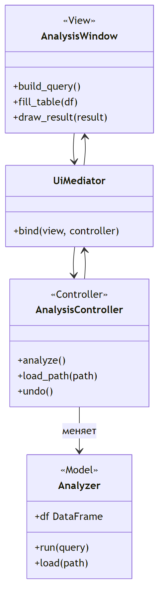
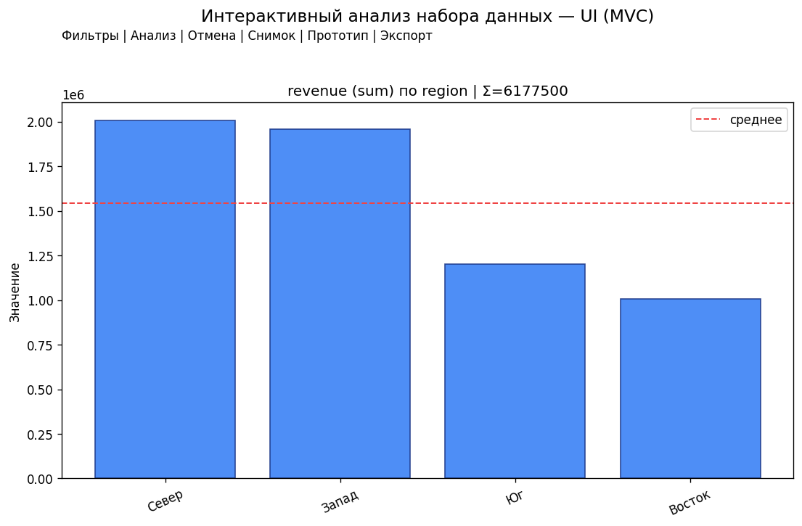

# Отчёт по лабораторной работе № 12

**Тема:** архитектурный паттерн MVC

## Цель работы

Разделить приложение анализа данных на Model, View и Controller.

## Вариант 13. Интерактивный анализ набора данных

`Analyzer` хранит данные и логику анализа (Model). `AnalysisWindow` отвечает только за отображение и ввод (View). `AnalysisController` обрабатывает действия пользователя (Controller). Связь View↔Controller идёт через посредника.

**Технологии:** Python 3.11, pandas, matplotlib, tkinter.

## Ход работы

### Паттерн MVC

- **Model** — `Analyzer`: загрузка, конвейер, результат, состояние.
- **View** — `AnalysisWindow`: таблица, график, комбобоксы, статус.
- **Controller** — `AnalysisController`: `analyze`, `load_path`, `undo`, экспорт.



*Рисунок 1 - Диаграмма классов MVC.*

```python
class AnalysisApp:
    def __init__(self, data_path=None):
        self.model = Analyzer(...)
        self.mediator = UiMediator()
        self.controller = AnalysisController(self.model, self.mediator)
        self.window = AnalysisWindow(self.model, self.mediator)
        self.mediator.bind(self.window, self.controller)
```

### Результат работы программы



*Рисунок 2 - Интерфейс View после запуска через MVC-сборку.*

## Вывод

MVC отделил данные и анализ от GUI: изменение отображения не затрагивает модель, а контроллер централизует реакции на действия пользователя.
