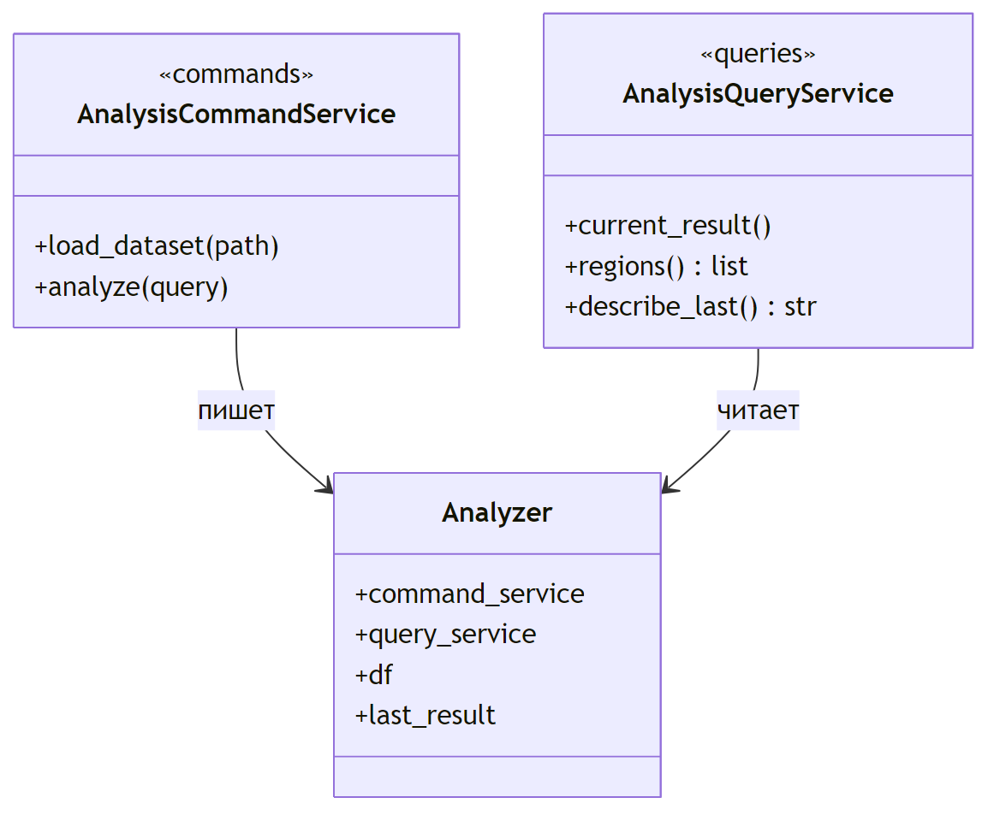
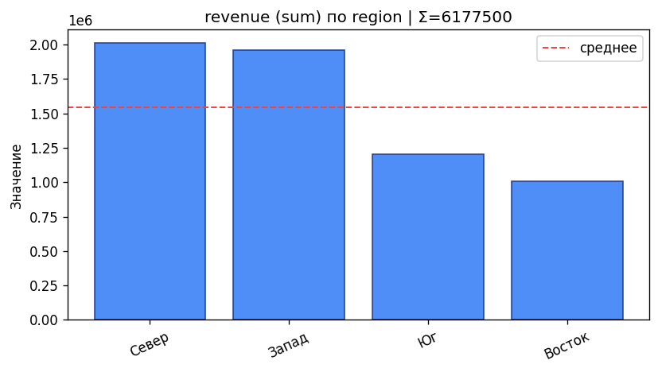

# Отчёт по лабораторной работе № 13

**Тема:** паттерн распределённых систем CQRS

## Цель работы

Разделить операции изменения состояния и операции чтения в приложении анализа.

## Вариант 13. Интерактивный анализ набора данных

Загрузка датасета и запуск анализа идут через `AnalysisCommandService`. Чтение регионов, последнего результата и описания запроса — через `AnalysisQueryService`.

**Технологии:** Python 3.11, pandas, matplotlib, tkinter.

## Ход работы

### Паттерн CQRS

Команды меняют модель (`load_dataset`, `analyze`). Запросы только читают (`regions`, `current_result`, `describe_last`) и не мутируют данные.



*Рисунок 1 - Диаграмма классов CQRS.*

```python
class AnalysisCommandService:
    def load_dataset(self, path): ...
    def analyze(self, query): ...

class AnalysisQueryService:
    def regions(self): ...
    def current_result(self): ...
```

### Результат работы программы



*Рисунок 2 - Результат, полученный после команды analyze и прочитанный query-сервисом.*

## Вывод

CQRS разделил запись и чтение в предметной области анализа продаж: контроллер явно использует разные сервисы для команд и запросов.
