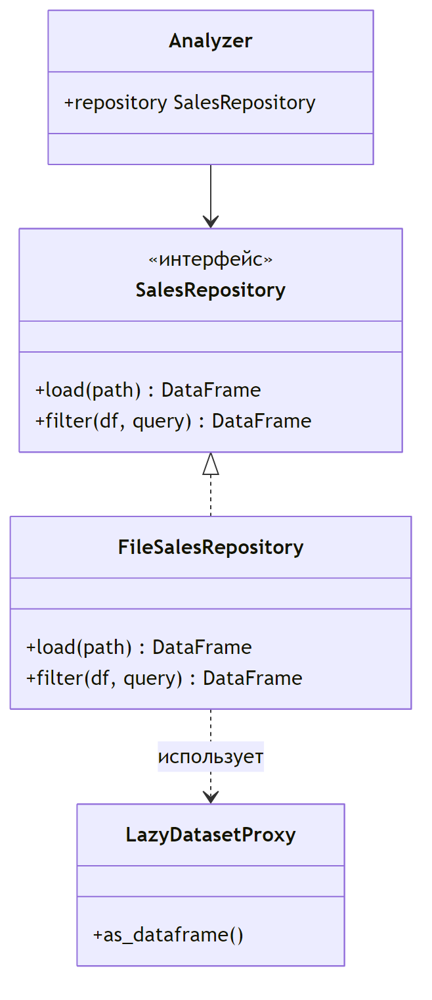
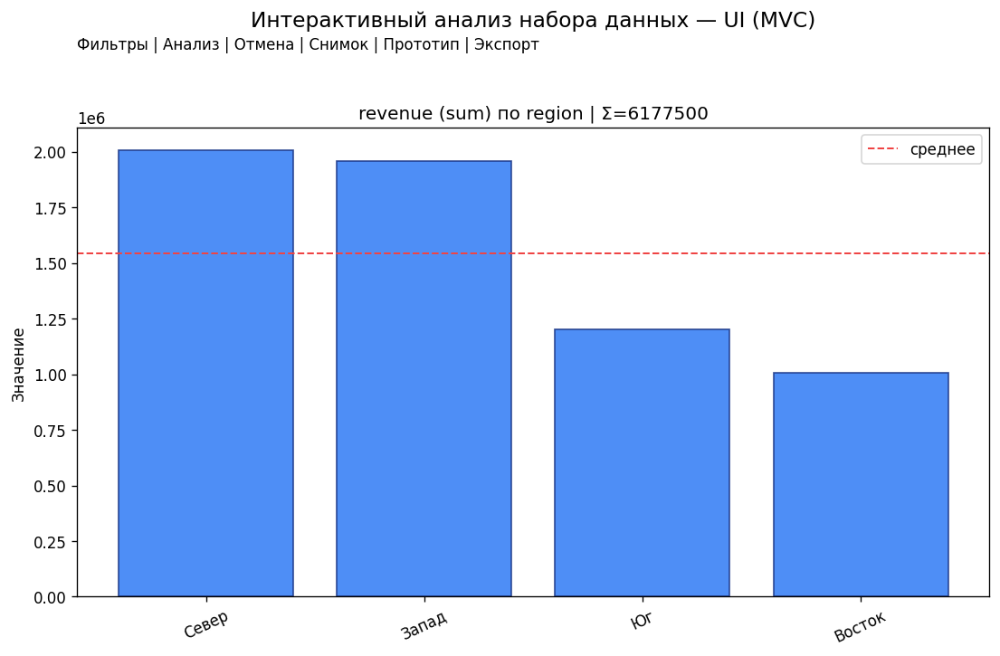

# Отчёт по лабораторной работе № 14

**Тема:** системный паттерн Repository

## Цель работы

Изолировать доступ к данным продаж за интерфейсом репозитория.

## Вариант 13. Интерактивный анализ набора данных

`SalesRepository` задаёт методы `load` и `filter`. `FileSalesRepository` читает файлы через `LazyDatasetProxy` и применяет фильтры запроса. Анализатор зависит от абстракции, а не от CSV/JSON напрямую.

**Технологии:** Python 3.11, pandas, matplotlib, tkinter.

## Ход работы

### Паттерн Repository

```python
class SalesRepository(ABC):
    def load(self, path: Path) -> pd.DataFrame: ...
    def filter(self, df, query) -> pd.DataFrame: ...

class FileSalesRepository(SalesRepository):
    def load(self, path):
        return load_dataset(path).as_dataframe()
```



*Рисунок 1 - Диаграмма классов Repository.*

### Результат работы программы



*Рисунок 2 - Данные, загруженные через FileSalesRepository.*

## Вывод

Репозиторий спрятал детали файлового доступа: модель работает с коллекцией строк продаж, не зная формата источника.
