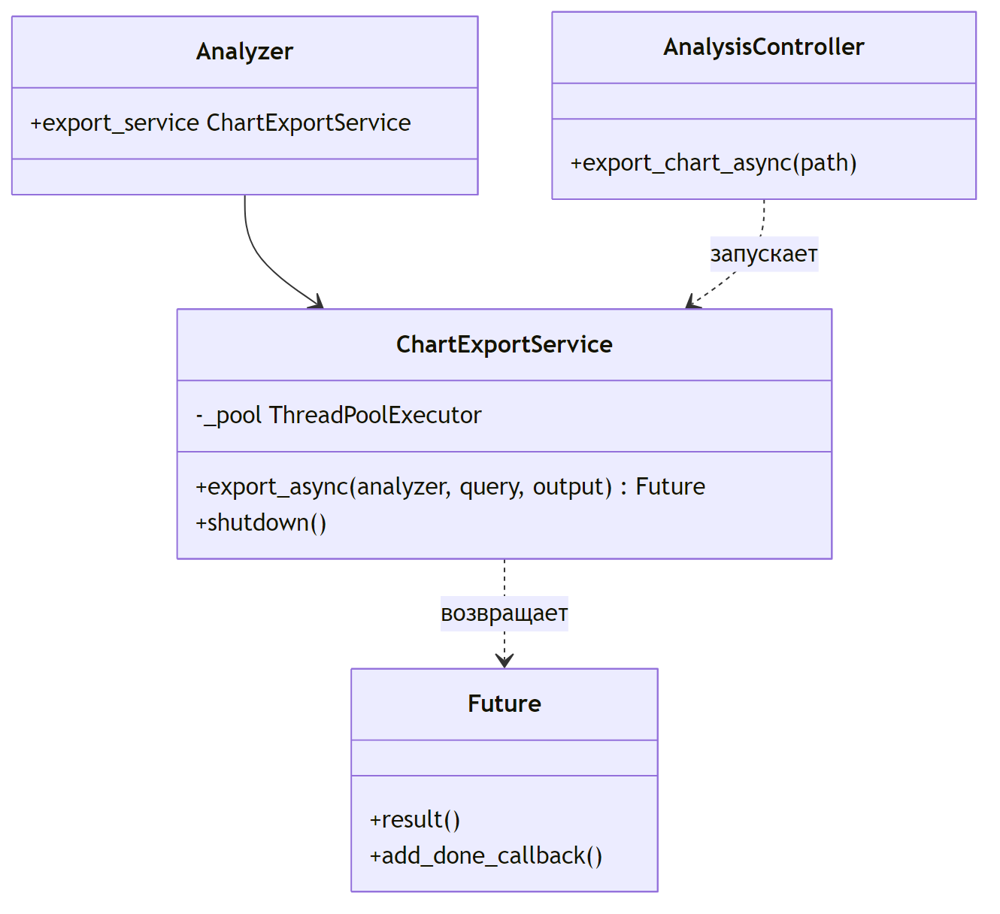

# Отчёт по лабораторной работе № 15

**Тема:** идиоматический паттерн Future / Thread Pool

## Цель работы

Вынести экспорт графика в фоновый пул потоков и получить результат через Future.

## Вариант 13. Интерактивный анализ набора данных

Кнопка «Фон. экспорт» запускает `ChartExportService.export_async`: работа выполняется в `ThreadPoolExecutor`, UI не блокируется, по завершении статус обновляется через `Future` callback.

**Технологии:** Python 3.11, concurrent.futures, pandas, matplotlib, tkinter.

## Ход работы

### Паттерн Future / Thread Pool

```python
class ChartExportService:
    def __init__(self, max_workers=2):
        self._pool = ThreadPoolExecutor(max_workers=max_workers)

    def export_async(self, analyzer, query, output, on_done=None) -> Future:
        return self._pool.submit(job)
```



*Рисунок 1 - Диаграмма классов Future / Thread Pool.*

### Результат работы программы


*Рисунок 2 - PNG, сохранённый фоновым экспортом.*

## Вывод

Пул потоков и Future позволили экспортировать график асинхронно, не зависая интерфейс анализа данных.
