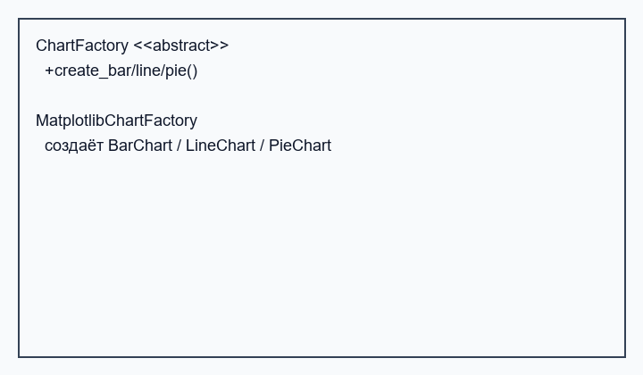
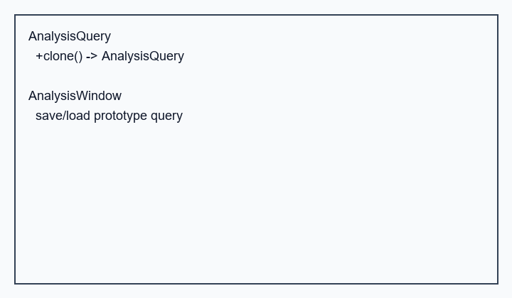
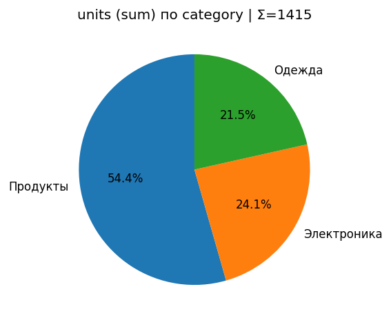

# Отчёт по лабораторной работе № 2

**Тема:** порождающие паттерны «Абстрактная фабрика», «Фабричный метод», «Прототип»

## Цель работы

Изучить порождающие паттерны «Абстрактная фабрика», «Фабричный метод» и «Прототип», а также применить два из них для решения задачи из предметной области.

## Вариант 13. Интерактивный анализ набора данных

Приложение анализирует продажи: фильтрует строки, группирует метрики и строит столбчатые, линейные и круговые графики.

**Выбранные паттерны:** «Абстрактная фабрика» и «Прототип».

**Технологии:** Python 3.11, pandas, matplotlib, tkinter.

## Ход работы

### Паттерн «Абстрактная фабрика»

Семейство графиков включает столбчатый, линейный и круговой виды. `ChartFactory` задаёт методы создания, а `MatplotlibChartFactory` возвращает конкретные реализации. Анализатор запрашивает график по имени (`bar` / `line` / `pie`) и не зависит от классов `BarChart`, `LineChart`, `PieChart`.



*Рисунок 1 - Диаграмма классов паттерна «Абстрактная фабрика».*

**Листинг 1 - Абстрактная фабрика графиков.**

```python
class ChartFactory:
    def create_bar(self):
        raise NotImplementedError

    def create_line(self):
        raise NotImplementedError

    def create_pie(self):
        raise NotImplementedError

    def create(self, kind: str):
        return {
            "bar": self.create_bar,
            "line": self.create_line,
            "pie": self.create_pie,
        }[kind]()


class MatplotlibChartFactory(ChartFactory):
    def create_bar(self):
        return BarChart()

    def create_line(self):
        return LineChart()

    def create_pie(self):
        return PieChart()
```

### Паттерн «Прототип»

Пользователь может сохранить текущий запрос как образец и позже загрузить его копию. Метод `AnalysisQuery.clone()` создаёт независимый объект через `deepcopy`, поэтому изменение загруженного запроса не портит сохранённый прототип.



*Рисунок 2 - Диаграмма классов паттерна «Прототип».*

**Листинг 2 - Клонирование запроса.**

```python
@dataclass
class AnalysisQuery:
    metric: str = "revenue"
    group_by: str = "region"
    # ... фильтры ...

    def clone(self) -> "AnalysisQuery":
        return copy.deepcopy(self)


class AnalysisWindow:
    def _save_prototype(self):
        self._prototype_query = self._current_query().clone()

    def _load_prototype(self):
        q = self._prototype_query.clone()
        self.metric_var.set(q.metric)
        self.group_var.set(q.group_by)
        # ... восстановление фильтров ...
        self._analyze()
```

### Результат работы программы



*Рисунок 3 - График, созданный фабрикой (`pie`), по единицам товара.*

## Вывод

В ходе работы применены паттерны «Абстрактная фабрика» и «Прототип»: фабрика создаёт семейство графиков, прототип копирует настроенный запрос анализа.
