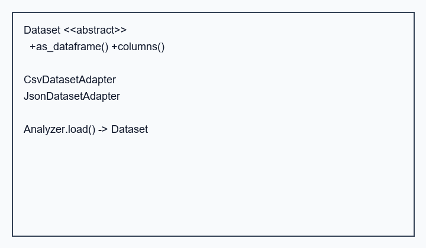
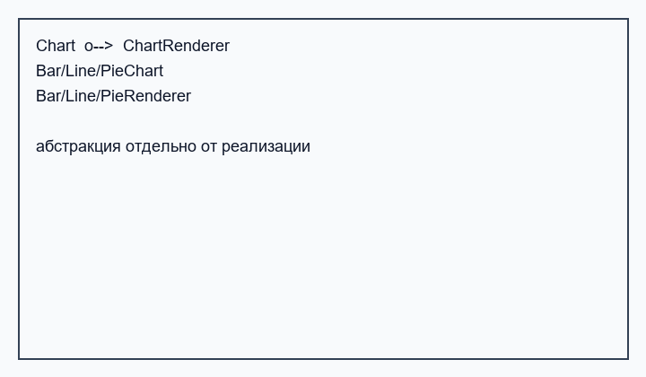
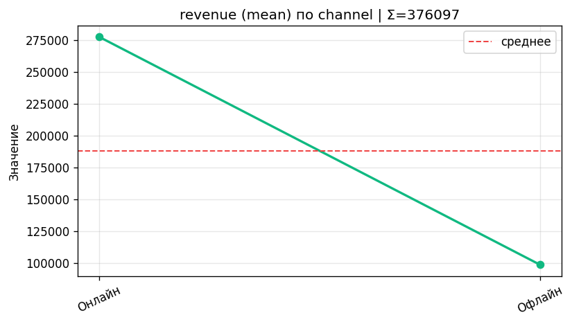

# Отчёт по лабораторной работе № 3

**Тема:** структурные паттерны «Адаптер» и «Мост»

## Цель работы

Реализовать решение задачи из предметной области в соответствии с вариантом с использованием паттернов «Адаптер» и «Мост».

## Вариант 13. Интерактивный анализ набора данных

Приложение принимает данные из разных форматов и рисует графики разными способами отрисовки, не смешивая логику анализа с деталями matplotlib.

**Технологии:** Python 3.11, pandas, matplotlib, tkinter.

## Ход работы

### Паттерн «Адаптер»

CSV и JSON читаются по-разному, а анализатору нужен единый интерфейс. `Dataset` задаёт методы `as_dataframe()` и `columns()`. `CsvDatasetAdapter` и `JsonDatasetAdapter` приводят файлы к этому интерфейсу.



*Исходник Mermaid: [adapter-class-diagram.mmd](assets/adapter-class-diagram.mmd).*

*Рисунок 1 - Диаграмма классов паттерна «Адаптер».*

**Листинг 1 - Адаптеры источников данных.**

```python
class Dataset:
    def as_dataframe(self):
        raise NotImplementedError


class CsvDatasetAdapter(Dataset):
    def __init__(self, path):
        self._df = pd.read_csv(path)

    def as_dataframe(self):
        return self._df.copy()


class JsonDatasetAdapter(Dataset):
    def __init__(self, path):
        with open(path, encoding="utf-8") as f:
            payload = json.load(f)
        self._df = pd.DataFrame(payload["records"] if isinstance(payload, dict) else payload)

    def as_dataframe(self):
        return self._df.copy()
```

### Паттерн «Мост»

Абстракция `Chart` отделена от реализации `ChartRenderer`. Столбчатый, линейный и круговой графики меняют рендерер независимо от остального кода анализа. Стиль берётся из приспособленца.



*Исходник Mermaid: [bridge-class-diagram.mmd](assets/bridge-class-diagram.mmd).*

*Рисунок 2 - Диаграмма классов паттерна «Мост».*

**Листинг 2 - Мост между графиком и рендерером.**

```python
class Chart:
    def __init__(self, renderer, style_name="default"):
        self.renderer = renderer
        self.style = STYLE_FLYWEIGHTS.get_style(style_name)

    def draw(self, ax, labels, values, title):
        self.renderer.render(ax, labels, values, self.style, title)


class BarChart(Chart):
    def __init__(self):
        super().__init__(BarRenderer(), "bar")
```

### Результат работы программы



*Рисунок 3 - Линейный график через мост Chart + LineRenderer.*

## Вывод

Паттерн «Адаптер» унифицировал загрузку CSV/JSON, паттерн «Мост» отделил вид графика от способа его отрисовки.
