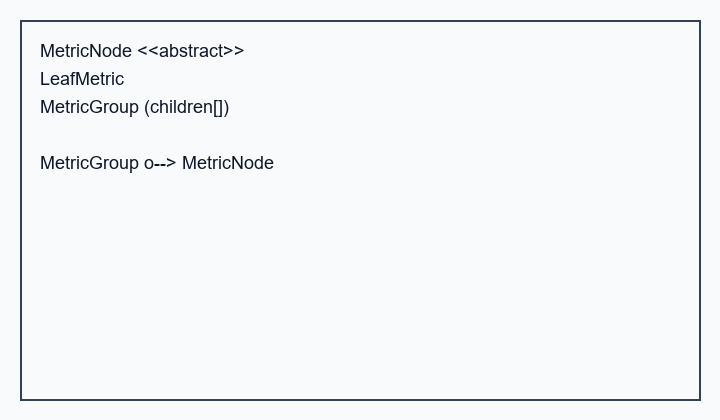
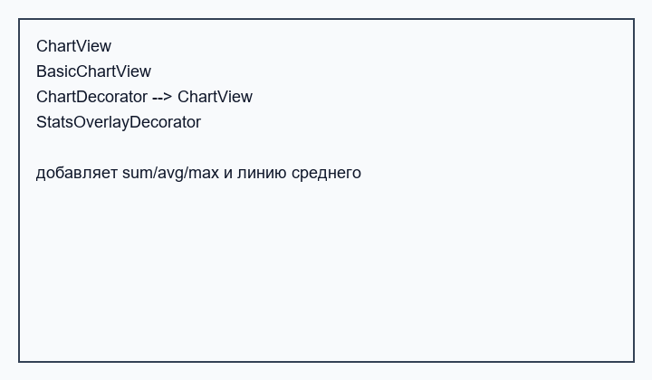

# Отчёт по лабораторной работе № 4

**Тема:** структурные паттерны «Компоновщик» и «Декоратор»

## Цель работы

Реализовать решение задачи из предметной области в соответствии с вариантом с использованием паттернов «Компоновщик» и «Декоратор».

## Вариант 13. Интерактивный анализ набора данных

Приложение считает сводные метрики и обогащает график статистикой без изменения базового класса построения диаграммы.

**Технологии:** Python 3.11, pandas, matplotlib, tkinter.

## Ход работы

### Паттерн «Компоновщик»

Метрики образуют дерево: листья (`LeafMetric`) считают сумму колонки, группы (`MetricGroup`) суммируют детей. Анализатор обходит дерево одним интерфейсом `MetricNode` и показывает сводку в панели результата.



*Рисунок 1 - Диаграмма классов паттерна «Компоновщик».*

Исходник Mermaid: [composite-class-diagram.mmd](assets/composite-class-diagram.mmd).

**Листинг 1 - Дерево метрик.**

```python
class MetricGroup(MetricNode):
    def __init__(self, name: str):
        self.name = name
        self.children = []

    def add(self, node: MetricNode):
        self.children.append(node)
        return self

    def evaluate(self, df):
        return sum(child.evaluate(df) for child in self.children)


def build_default_metric_tree():
    root = MetricGroup("Сводка")
    sales = MetricGroup("Продажи")
    sales.add(LeafMetric("Выручка", "revenue"))
    sales.add(LeafMetric("Единицы", "units"))
    root.add(sales)
    return root
```

### Паттерн «Декоратор»

`BasicChartView` строит обычный график. `StatsOverlayDecorator` оборачивает его, добавляет сумму/среднее/максимум в результат и рисует линию среднего на диаграмме, не меняя код базового представления.



*Рисунок 2 - Диаграмма классов паттерна «Декоратор».*

Исходник Mermaid: [decorator-class-diagram.mmd](assets/decorator-class-diagram.mmd).

**Листинг 2 - Декоратор статистики.**

```python
class StatsOverlayDecorator(ChartDecorator):
    def build(self, df, query):
        result = self._wrapped.build(df, query)
        if result.values:
            result.extras["sum"] = sum(result.values)
            result.extras["avg"] = sum(result.values) / len(result.values)
            result.extras["max"] = max(result.values)
            result.title = f"{result.title} | Σ={result.extras['sum']:.0f}"
        return result

    def draw(self, ax, result):
        self._wrapped.draw(ax, result)
        if "avg" in result.extras and result.extras.get("chart_kind") != "pie":
            ax.axhline(result.extras["avg"], color="#EF4444", linestyle="--")
```

### Результат работы программы


*Рисунок 3 - График с суммой в заголовке и линией среднего.*

## Вывод

«Компоновщик» объединил метрики в дерево, «Декоратор» добавил статистику поверх базового построения графика.
