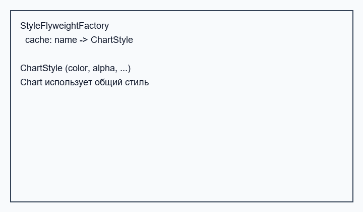
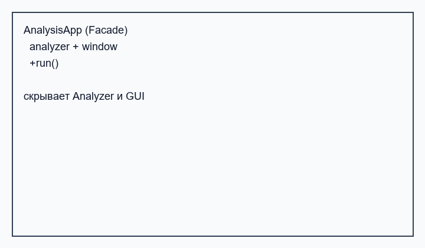
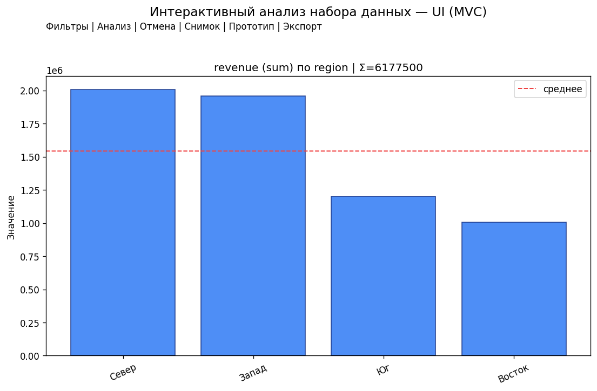

# Отчёт по лабораторной работе № 5

**Тема:** структурные паттерны «Фасад» и «Приспособленец»

## Цель работы

Реализовать решение задачи из предметной области в соответствии с вариантами (пп. 1.4) с использованием паттернов из списка: «Фасад», «Приспособленец».

## Вариант 13. Интерактивный анализ набора данных

Приложение скрывает сложную сборку анализатора и окна за одним входом `AnalysisApp().run()`, а стили графиков переиспользуются через кэш.

**Технологии:** Python 3.11, pandas, matplotlib, tkinter.

## Ход работы

### Паттерн «Приспособленец»

Цвета и параметры оформления одинаковы для многих графиков одного типа. `StyleFlyweightFactory` хранит `ChartStyle` в словаре по имени (`bar`, `line`, `pie`) и при повторном запросе возвращает уже созданный объект.



*Рисунок 1 - Диаграмма классов паттерна «Приспособленец».*

Исходник Mermaid: [flyweight-class-diagram.mmd](assets/flyweight-class-diagram.mmd).

**Листинг 1 - Кэширование стилей.**

```python
class StyleFlyweightFactory:
    def __init__(self):
        self._styles = {}

    def get_style(self, name: str) -> ChartStyle:
        if name not in self._styles:
            presets = {
                "bar": ChartStyle("#3B82F6", "#1E3A8A", 0.9, 12),
                "line": ChartStyle("#10B981", "#065F46", 0.95, 12),
                "pie": ChartStyle("#F59E0B", "#92400E", 0.9, 12),
            }
            self._styles[name] = presets[name]
        return self._styles[name]


STYLE_FLYWEIGHTS = StyleFlyweightFactory()
```

### Паттерн «Фасад»

Точка входа не требует вручную собирать фабрику, анализатор и окно. `AnalysisApp` создаёт зависимости и запускает GUI одним методом `run()`.



*Рисунок 2 - Диаграмма классов паттерна «Фасад».*

Исходник Mermaid: [facade-class-diagram.mmd](assets/facade-class-diagram.mmd).

**Листинг 2 - Фасад запуска.**

```python
class AnalysisApp:
    """Упрощённый интерфейс запуска приложения анализа данных."""

    def __init__(self, data_path=None):
        self.analyzer = Analyzer(MatplotlibChartFactory())
        self.window = AnalysisWindow(self.analyzer)

    def run(self):
        self.window.run()


if __name__ == "__main__":
    AnalysisApp().run()
```

### Результат работы программы



*Рисунок 3 - Приложение после запуска через фасад.*

## Вывод

«Приспособленец» переиспользует стили графиков, «Фасад» даёт простой вход в приложение анализа данных.
