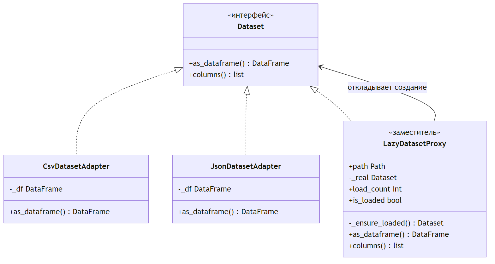

# Отчёт по лабораторной работе № 6

**Тема:** структурный паттерн «Заместитель»

## Цель работы

Реализовать решение задачи из предметной области с использованием паттерна «Заместитель».

## Вариант 13. Интерактивный анализ набора данных

Приложение открывает CSV/JSON через заместителя: реальный адаптер создаётся только при первом чтении данных.

**Технологии:** Python 3.11, pandas, matplotlib, tkinter.

## Ход работы

### Паттерн «Заместитель»

`LazyDatasetProxy` реализует тот же интерфейс `Dataset`, что и адаптеры CSV/JSON. Пока пользователь не запросит `as_dataframe()` или `columns()`, файл с диска не читается. Счётчик `load_count` показывает, что реальное чтение выполняется один раз.



*Рисунок 1 - Диаграмма классов паттерна «Заместитель».*

**Листинг 1 — Ленивый заместитель набора данных.**

```python
class LazyDatasetProxy(Dataset):
    def __init__(self, path: Path):
        self.path = Path(path)
        self._real = None
        self.load_count = 0

    def _ensure_loaded(self) -> Dataset:
        if self._real is None:
            self._real = open_raw_dataset(self.path)
            self.load_count += 1
        return self._real

    def as_dataframe(self):
        return self._ensure_loaded().as_dataframe()
```

### Результат работы программы


*Рисунок 2 - Анализ после загрузки через LazyDatasetProxy.*

## Вывод

Паттерн «Заместитель» отложил чтение файла до первого обращения и сохранил единый интерфейс `Dataset` для анализатора.
