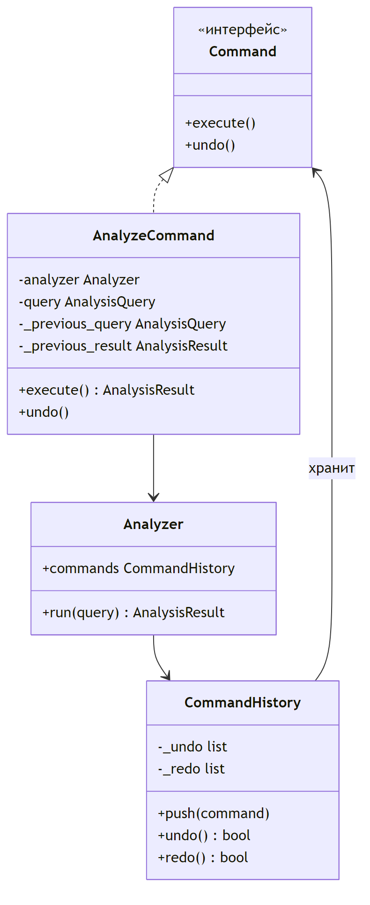
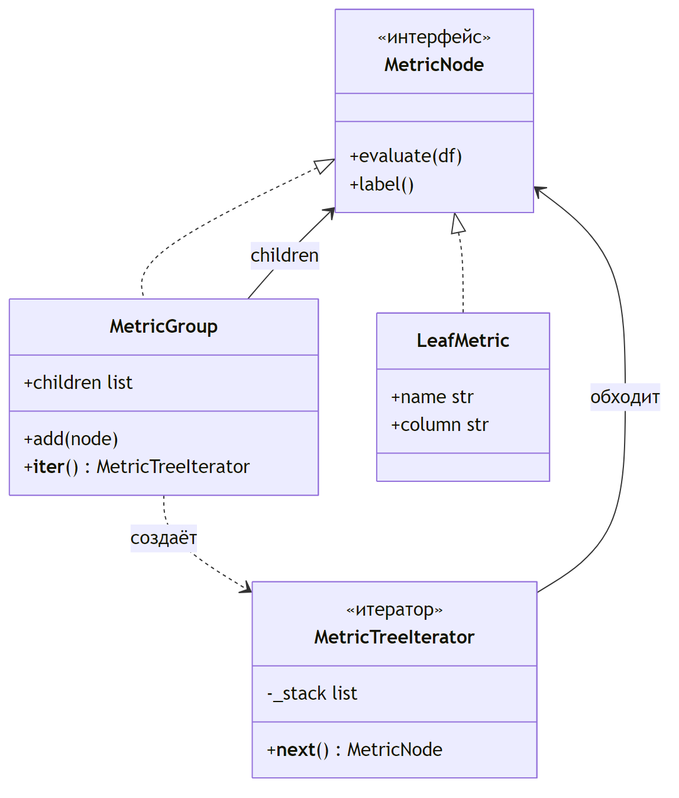

# Отчёт по лабораторной работе № 7

**Тема:** поведенческие паттерны «Команда» и «Итератор»

## Цель работы

Реализовать решение задачи с использованием паттернов «Команда» и «Итератор».

## Вариант 13. Интерактивный анализ набора данных

Анализ запускается командой с поддержкой отмены; дерево метрик обходится итератором без раскрытия внутренней структуры.

**Технологии:** Python 3.11, pandas, matplotlib, tkinter.

## Ход работы

### Паттерн «Команда»

`AnalyzeCommand` сохраняет предыдущий запрос и результат, выполняет новый анализ и умеет откатить состояние. `CommandHistory` хранит стеки undo/redo. В GUI кнопка «Отмена» вызывает историю команд.



*Рисунок 1 - Диаграмма классов паттерна «Команда».*

```python
class AnalyzeCommand(Command):
    def execute(self):
        self._previous_query = self.analyzer.last_query.clone() if self.analyzer.last_query else None
        self._previous_result = self.analyzer.last_result
        self.result = self.analyzer.run_pipeline(self.query)
        return self.result

    def undo(self):
        self.analyzer.last_query = self._previous_query
        self.analyzer.last_result = self._previous_result
```

### Паттерн «Итератор»

`MetricTreeIterator` обходит `MetricGroup` в глубину через стек. Сводка в панели результата строится перебором листьев итератором, а не ручным рекурсивным кодом в контроллере.



*Рисунок 2 - Диаграмма классов паттерна «Итератор».*

```python
class MetricTreeIterator:
    def __init__(self, root: MetricNode):
        self._stack = [root]

    def __next__(self):
        if not self._stack:
            raise StopIteration
        node = self._stack.pop()
        if isinstance(node, MetricGroup):
            self._stack.extend(reversed(node.children))
        return node
```

### Результат работы программы


*Рисунок 3 - Сводка метрик, собранная итератором.*

## Вывод

«Команда» инкапсулировала запуск анализа с отменой, «Итератор» — единообразный обход дерева метрик.
