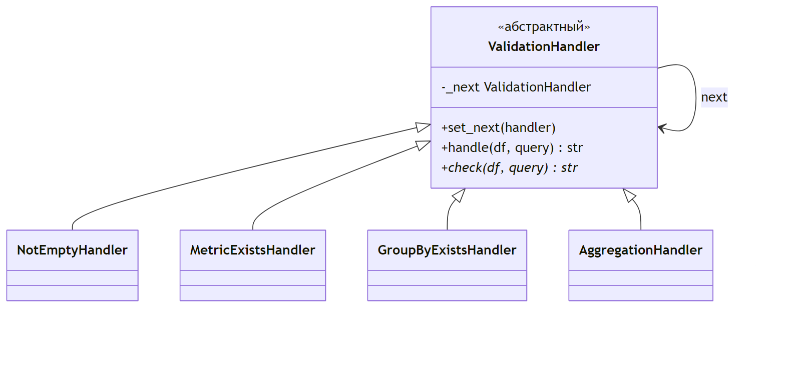
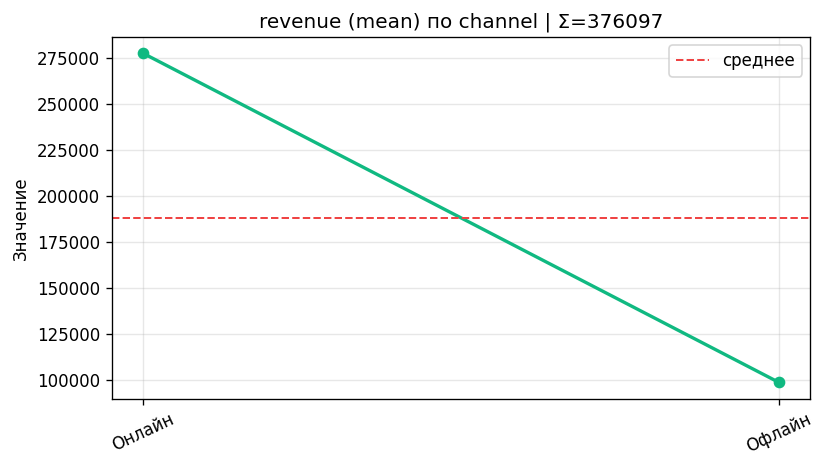

# Отчёт по лабораторной работе № 8

**Тема:** поведенческий паттерн «Цепочка обязанностей»

## Цель работы

Реализовать валидацию запроса анализа через цепочку обработчиков.

## Вариант 13. Интерактивный анализ набора данных

Перед агрегацией запрос проходит цепочку: пустой датасет → наличие метрики → поле группировки → допустимая агрегация.

**Технологии:** Python 3.11, pandas, matplotlib, tkinter.

## Ход работы

### Паттерн «Цепочка обязанностей»

Каждый `ValidationHandler` либо возвращает текст ошибки, либо передаёт запрос следующему звену. Конвейер `AnalysisPipeline` вызывает `handle()` один раз и не знает о конкретных проверках.



*Рисунок 1 - Диаграмма классов паттерна «Цепочка обязанностей».*

```python
head = NotEmptyHandler()
head.set_next(MetricExistsHandler()).set_next(GroupByExistsHandler()).set_next(AggregationHandler())

error = head.handle(df, query)  # None, если все проверки пройдены
```

### Результат работы программы



*Рисунок 2 - Успешный анализ после прохождения цепочки валидации.*

## Вывод

Цепочка обязанностей разделила проверки запроса на независимые звенья и упростила добавление новых правил.
