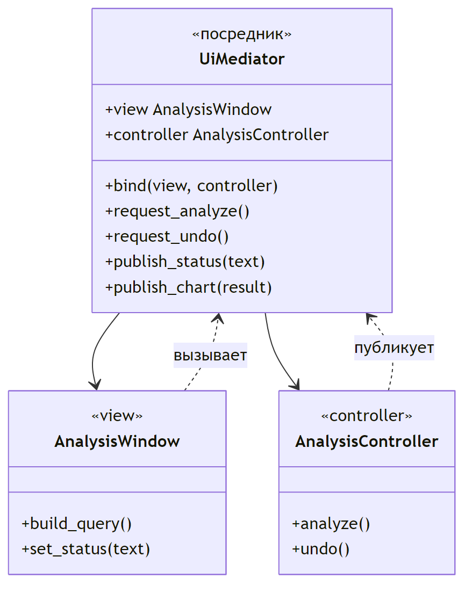
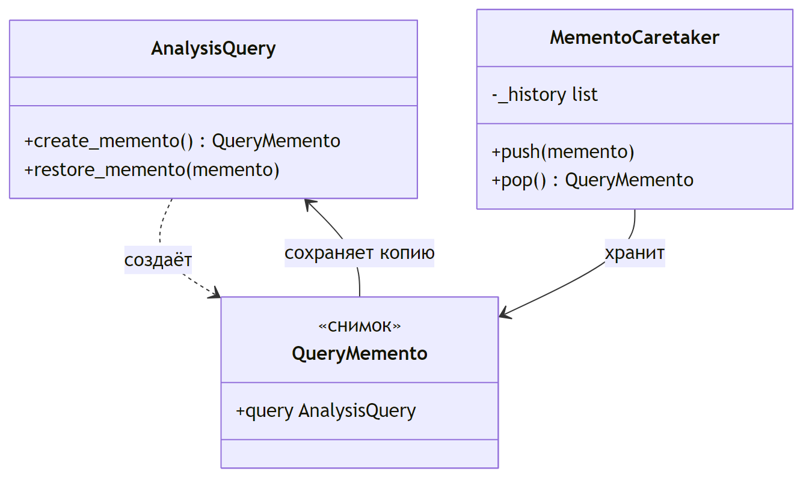
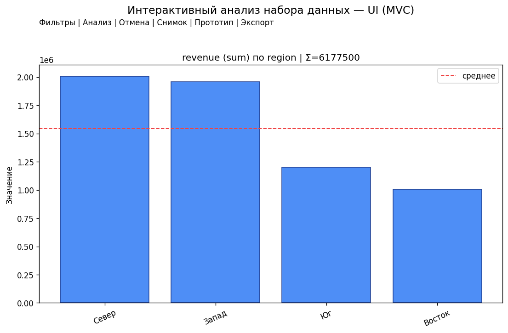

# Отчёт по лабораторной работе № 9

**Тема:** поведенческие паттерны «Посредник» и «Снимок»

## Цель работы

Реализовать взаимодействие UI через посредника и сохранение состояния запроса снимками.

## Вариант 13. Интерактивный анализ набора данных

Окно и контроллер не вызывают друг друга напрямую — общаются через `UiMediator`. Кнопки «Снимок» / «Восстановить» сохраняют и откатывают параметры запроса.

**Технологии:** Python 3.11, pandas, matplotlib, tkinter.

## Ход работы

### Паттерн «Посредник»

`UiMediator` связывает View и Controller: запросы анализа/отмены идут в контроллер, статусы и графики публикуются обратно во View.



*Рисунок 1 - Диаграмма классов паттерна «Посредник».*

### Паттерн «Снимок»

`AnalysisQuery.create_memento()` сохраняет копию запроса в `QueryMemento`. `MementoCaretaker` хранит историю снимков; восстановление возвращает фильтры в элементы управления.



*Рисунок 2 - Диаграмма классов паттерна «Снимок».*

```python
memento = query.create_memento()
caretaker.push(memento)
# ...
restored = caretaker.pop()
query.restore_memento(restored)
```

### Результат работы программы



*Рисунок 3 - Панель с кнопками снимка и восстановления.*

## Вывод

«Посредник» убрал прямые связи View↔Controller, «Снимок» сохранил историю параметров анализа без нарушения инкапсуляции запроса.
